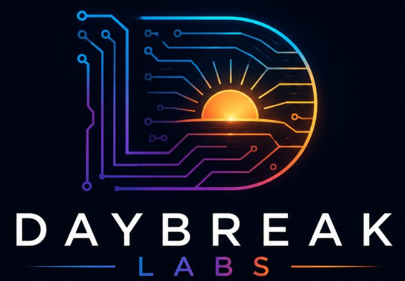
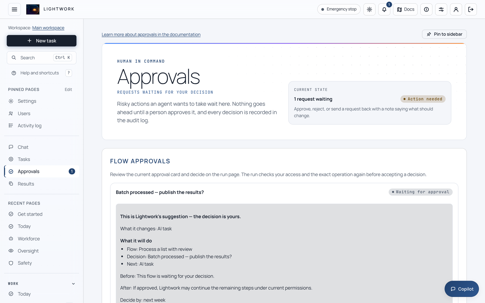

<p align="center">
  
</p>

<h1 align="center">Lightwork</h1>

<p align="center">
  <b>The governed digital workforce.</b><br>
  Teams of AI specialists that take recurring business work off your plate and carry it to the point
  of decision, under the budgets, approvals and audit trail a business already runs&nbsp;on.
</p>

<p align="center">
  <a href="https://github.com/Daybreak-AI-Labs/LightworkOS/actions/workflows/ci.yml"></a>
  <a href="LICENSE"></a>
  <a href="docs/source-install.md"></a>
  
</p>

<p align="center">
  <b>Alpha.</b> Version 0.1.7 is unreleased: you install from source, and configuration and APIs
  can change (<a href="CHANGELOG.md">CHANGELOG.md</a>).
</p>

<p align="center">
  <picture><source media="(prefers-color-scheme: dark)" srcset="docs/assets/screenshots/approvals-dark.webp"></picture>
  <br><sub>Work paused at its approval step, waiting for a person. Captured on a fresh install with no AI provider connected.</sub>
</p>

Lightwork is building the digital workforce. A business does not need another
chat window. It needs the invoice exceptions matched, the renewal deadlines
caught and the ticket queue triaged, with a person accountable for every
decision. Lightwork's teams do the checking and preparation and hand each
decision to its owner, so the business keeps functioning as a business. It
is open source and runs on your machines or cloud, with your model keys or
local models.

## What Lightwork takes off your plate

Each starter team takes one recurring function. You give it an approved export
from your own system, such as an invoice register. It gives back an exception
worklist: every finding tied to its source row, with a proposed next step.

| Function | What the team hands back | What stays with a person |
|---|---|---|
| AP and purchasing exceptions | Invoices that disagree with the purchase order or receipt, missing supplier acknowledgements, overdue receiving | Releasing payments, changing orders |
| Contract obligations and renewals | Action packets for notices due within 30 days, obligations with no owner and missing clause references | Sending notices, signing, legal conclusions |
| Security questionnaires | Answers with no approved text or evidence, and answer reviews that have expired | Submitting the questionnaire, any security claim |
| IT service desk | Tickets missing an owner, an approved runbook or diagnostic evidence, and responses coming due | Running commands, resetting access |
| Inventory planning | Stock that will not cover lead-time demand or exceeds its maximum, and items with no supplier | Purchase orders, stock targets |
| Construction project controls | RFI, submittal and change decisions due within three days, or missing a drawing reference or owner | Approving submittals, signing change orders |

The catalog also covers compliance, vendor assurance, privacy, audit
readiness, onboarding, revenue operations, billing, releases, management
reporting, orders, logistics, quality, maintenance and business continuity
([full catalog](docs/starter-teams.md#catalog-coverage)).

## How far a team carries the work

1. **Checks, with no AI needed.** The team runs its declared checks (matching values, required fields, deadlines, duplicates). Each finding names the rule, the source row, a fingerprint (SHA-256) of that row and a proposed action, and waits for a person's review. No AI is called and nothing outside Lightwork changes.
2. **Specialist drafts, after you approve the plan:** the exact evidence, team, tools, and total spending and time limits. The first specialist checks scope and missing inputs, later ones draft cited findings and owner actions, and the last independently reviews the draft and lists the decisions you need to make. Each receives the previous result and its fingerprint, and the final draft waits for the owner's acceptance.
3. **On a schedule** with a start and end, at least an hour between runs, a run limit, and per-run and total spending caps. Each new export still needs its own approval.

**Teams prepare; people decide.** A team cannot pay, send, sign, publish,
grant access or deploy. Every run is a saved case you can return to. Open
**Workforce**, then **Starter teams**; the Copilot panel offers the same
operations under the same permissions.

## Autonomous Shoring

Starter teams are the front line of Autonomous Shoring: moving a whole
business function, such as accounts payable or tier-1 support, onto Lightwork
and measuring whether it is working. You hand over a function, with an owner
and a target, not a prompt.

- **Book of Work.** Each function, its department, owner, target service levels and stage, from planning to proving results.
- **Service levels from real work.** Items completed per day, the share that needed a person and the longest time to finish, measured from completed tasks. Each target shows met, at risk, breached or no data.
- **Exception desk.** The approvals waiting on a person for that function.
- **Savings estimate** from your own hourly-rate and hours-per-task assumptions, minus the AI cost; an estimate, not proof of realized savings.

Open **Autonomous Shoring** in the dashboard. It is on by default.

## Cortex

Cortex is the company brain: one governed way to recall what the business
knows and to add to it. It draws on documents (each answer cited), learned
skills, lessons from past mistakes, the Operating Record of decisions and
approvals, and memory deposited by enrolled outside agents.

- **Exact to the workspace.** Every read is limited to the active workspace (tenant); nothing is pooled across workspaces.
- **On the record.** Every read and write leaves a signed audit row: who asked, which sources answered, which were denied and why, and a digest of the question, never its text.
- **No silent gaps.** A source that is off or broken is reported with its reason.
- **Outside agents checked first** by the Agent Trust Plane, and limited to scoped fleet memory.

Open **Cortex** in the dashboard, or run `lightwork cortex status`. It is on by
default; document search and outside-agent memory start off.

## Beyond the starter teams

Lightwork also runs open-ended tasks (an orchestrator hands parts to parallel
sub-agents, and a separate verifier checks the answer), visual workflows, and
skills learned under an administrator's review. It connects to business
software, MCP servers and chat channels such as Slack, and every connector
write waits for a person. You supervise it from one dashboard, a CLI or the
API.

## How well it works

| What was checked | Result | Evidence |
|---|---|---|
| Starter teams | Every team's sample produces exactly its expected findings, with provenance, no AI calls and no outside effects | [`test_starter_teams.py`](packages/maverick-core/tests/test_starter_teams.py) |
| Governance guarantees (`python proof/run_proof.py`) | **7 of 7** pass, including no money-moving tool in any finance specialist and segregation of duties | [proof/RESULTS.md](proof/RESULTS.md) |
| Unsafe actions (governance frontier benchmark) | **72 of 72** scripted unsafe actions blocked; **48 of 48** harmless look-alikes allowed | [results](benchmarks/GOVERNANCE_FRONTIER_RESULTS.md) |
| Cost of the controls (harness overhead benchmark) | **No** extra model calls or tokens; identical answers in **36 of 36** pairs; median **17.87 ms** per task | [results](benchmarks/HARNESS_OVERHEAD_RESULTS.md) |
| Prompt-attack screening (Agent Shield) | **83.9%** of 31 held-out attacks caught at the medium threshold the dashboard and setup wizard choose, **71.0%** at the high threshold used when no settings file exists; 2 of 32 harmless prompts flagged at both | [results](benchmarks/security/RESULTS.md) |
| Engineering | **47,000+** tests; more than 20 CI gates beyond the linter | [CONTRIBUTING.md](CONTRIBUTING.md#lint-and-ci-gates) |

**Read these for what they are.** All run offline with no live model, so they
show that the checks and controls work and what they cost, not how well AI
drafts the work; no live-model results are recorded yet. Benchmark manifests
are signed on the measuring host: they show the files match the run, not who
ran it.

## Behind the teams: the specialists

Each team is a small roster of built-in specialists; the AP team pairs a
procure-to-pay exceptions specialist with a purchase-order follow-up
specialist. A specialist is a governed job definition, not a free-roaming
agent: allowed and denied tools, a risk ceiling, a workflow and a result
contract.

<!-- The only specialist counts in this README. Recompute before editing:
     packs = files in packages/maverick-core/maverick/domains/*.toml; suites = distinct
     maverick.domain.suite_for() values; blocked = packs whose
     maverick.domain_edit.workflow_readiness() is "needs_setup" on a fresh install. -->

A catalog's size is not its capability. Lightwork ships 2,031 specialist packs
in 54 business suites, but a pack starts only when every tool its
workflow names is available. On a fresh install that blocks 965 of them: 686
need only web search (`[capabilities] web_search = true`), and the rest need
a connection for a named tool. Starter teams avoid that gap by running their
specialists over the evidence you approved instead of fetching it.

## Why it is built this way

A business can hand work only to something it can hold to account.

- **A person approves what matters.** A connector write is sent only after a person approves that exact request; the agent cannot approve its own, and no setting removes the step. Shell commands and high-risk actions also ask. *Accountability stays with people.*
- **Budgets are hard limits** on tokens, dollars, time and tool calls, checked whenever usage is recorded. *Spend works like a purchase order, not an open tab.*
- **Work runs in a sandbox you choose:** all shell goes through one layer that Docker, Podman or Kubernetes can isolate. *You decide what the work can touch.*
- **The record is signed.** Audit events are hash-chained and signed by default. Tamper-evident against the service account only with off-host custody: by default the key sits on the same host, so set `MAVERICK_AUDIT_SIGNING_KEY` and keep [checkpoints](docs/audit-checkpoints.md) off-host. *Auditors ask who did what, and who approved it.*
- **Workspaces stay separate.** With multi-tenancy on, each gets its own database, memory, audit log and encryption key. *A firm serving many clients keeps their records apart.*
- **You own model choice:** each role picks its own model, cloud or local. *Models change often; your controls should not.*
- **No single filter.** Agent Shield screens tasks, tool calls and answers, but the kernel runs without it unless you require it. *The guarantees come from the controls above.*

## Quickstart

Requires Git and Python 3.11 or 3.12. Docker or Podman is optional but recommended.

```bash
git clone https://github.com/Daybreak-AI-Labs/LightworkOS
cd LightworkOS
python3 -m venv .venv
. .venv/bin/activate
python -m pip install --upgrade pip
python scripts/install_release_cohort.py --core-extra release-runtime,evidence-analysis
lightwork doctor     # exits 1 until an AI provider is connected; expected at first
lightwork dashboard  # http://127.0.0.1:8765
```

On Windows, use the [PowerShell commands](docs/source-install.md#windows-powershell);
checks are in [Install from source](docs/source-install.md). The dashboard
has you create the owner account, then connect an AI provider. Starter-team
sample checks run without one. With a provider connected, try:

```bash
lightwork start "Draft a one-page plan to reduce our customer support response time \
without adding headcount. State your assumptions and the facts you need from me."
```

> [!WARNING]
> **By default, agent commands run directly on this computer** (the `local` sandbox), with no isolation from its files or network. Each shell command waits for a person to approve it, but an approved command runs with your account's access. Use Docker or Podman (`--sandbox docker`) for any task you would not run yourself, and read the [execution posture](SECURITY.md#execution-posture) first.

More to try without an AI key, and what is on by default: [technical overview](docs/technical-overview.md#try-it-without-an-ai-key).

## Limits

- **Alpha:** no release yet, and configuration and APIs can change.
- **No isolation by default:** see the warning above.
- **Teams work from what you supply.** They do not fetch from your systems, and their checks trust the values in the export you approve.
- **Starter teams are qualified offline** on synthetic samples only, not yet for live AI output or customer acceptance ([details](docs/starter-teams.md#what-qualification-means)).
- **Connectors** are tested against synthetic responses only ([connectors](docs/connectors.md)).
- **No external penetration test** has been published ([threat model](docs/security/threat-model.md)).

Shield, egress and encryption-key limits: [Safety and audit in depth](docs/technical-overview.md#safety-and-audit-in-depth).

## Documentation

| Topic | Where |
|---|---|
| How it works: controls, defaults, task flow, sandboxes, interfaces, packages | [docs/technical-overview.md](docs/technical-overview.md), [ARCHITECTURE.md](ARCHITECTURE.md) |
| Starter teams and Autonomous Shoring | [docs/starter-teams.md](docs/starter-teams.md), [docs/technical-overview.md](docs/technical-overview.md#autonomous-shoring-and-cortex-where-they-live) |
| Install, first run and configuration | [docs/source-install.md](docs/source-install.md), [docs/getting-started.md](docs/getting-started.md), [docs/configuration.md](docs/configuration.md) |
| Safety, hardening and deployment | [docs/safety.md](docs/safety.md), [docs/security-hardening.md](docs/security-hardening.md), [SECURITY.md](SECURITY.md), [docs/deployment.md](docs/deployment.md) |
| APIs and MCP clients | [docs/api.md](docs/api.md); [TypeScript](docs/clients/typescript-quickstart.md), [Go](docs/clients/go-quickstart.md), [Rust](docs/clients/rust-quickstart.md), [C#](docs/clients/csharp-quickstart.md), [Java](docs/clients/java-quickstart.md) |
| Connectors, plugins and compliance | [docs/connectors.md](docs/connectors.md), [docs/plugins.md](docs/plugins.md), [docs/compliance/README.md](docs/compliance/README.md) |
| Benchmarks, features and changes | [benchmarks/README.md](benchmarks/README.md), [docs/FEATURES.md](docs/FEATURES.md), [CHANGELOG.md](CHANGELOG.md) |

The command-line tool is installed as both `lightwork` and `maverick`; code
and settings use the original codename, `maverick`.

## Contributing

Contributions are welcome: start with [CONTRIBUTING.md](CONTRIBUTING.md). Your
first pull request signs the [Contributor License Agreement](CLA.md), and
participation follows the [Code of Conduct](CODE_OF_CONDUCT.md). See also
[GOVERNANCE.md](GOVERNANCE.md), [MAINTAINERS.md](MAINTAINERS.md),
[RELEASING.md](RELEASING.md) and [SUPPORT.md](SUPPORT.md). Report
vulnerabilities privately as [SECURITY.md](SECURITY.md) describes.

## License

Lightwork is licensed under the [Apache License 2.0](LICENSE); see also [NOTICE](NOTICE) and [THIRD-PARTY-NOTICES.md](THIRD-PARTY-NOTICES.md). The Lightwork name and logo are trademarks and are not covered by the license; see [TRADEMARK.md](TRADEMARK.md).

Lightwork is developed by Daybreak AI Labs; copyright is held by Christopher Day (see [NOTICE](NOTICE)).
