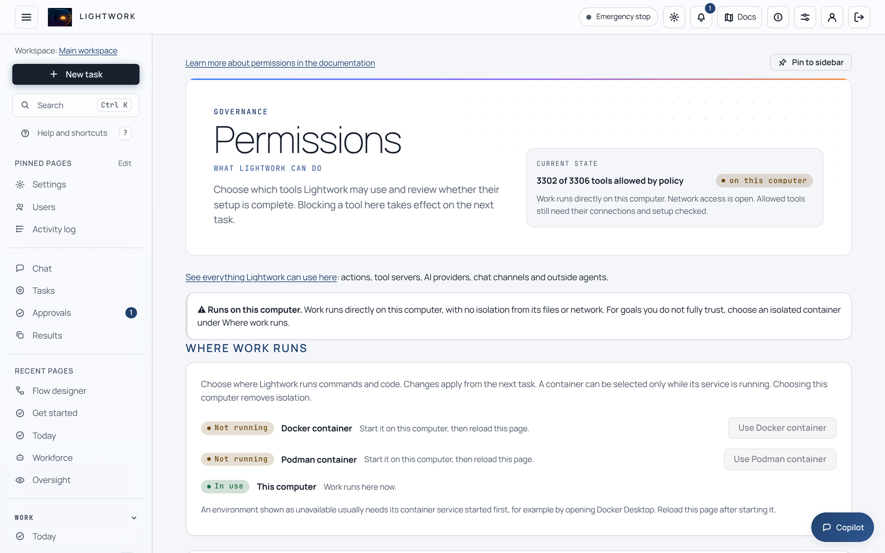
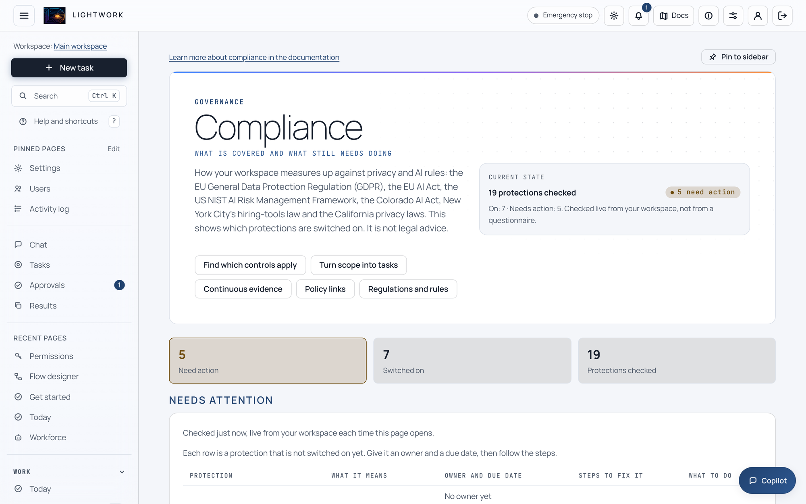
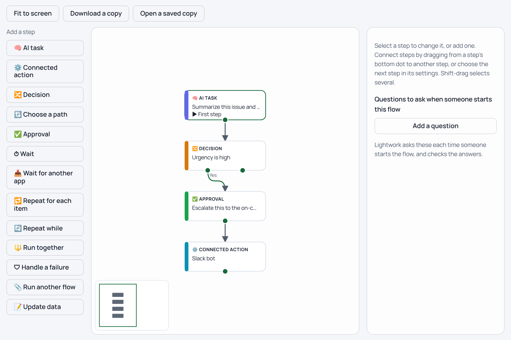
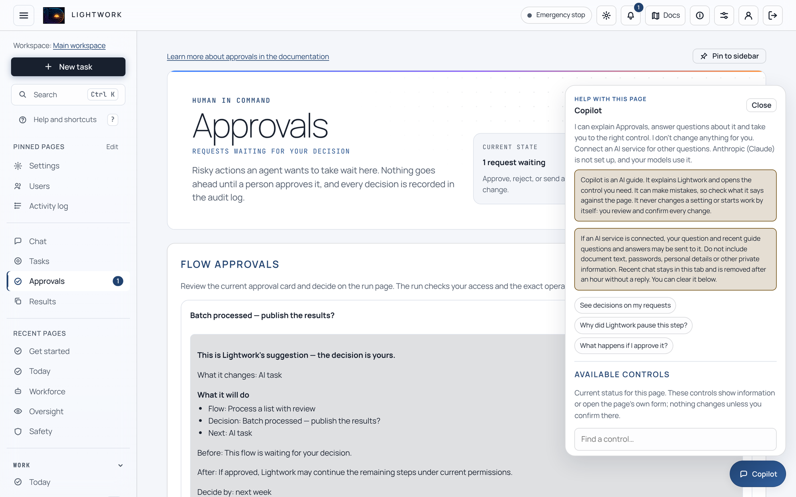
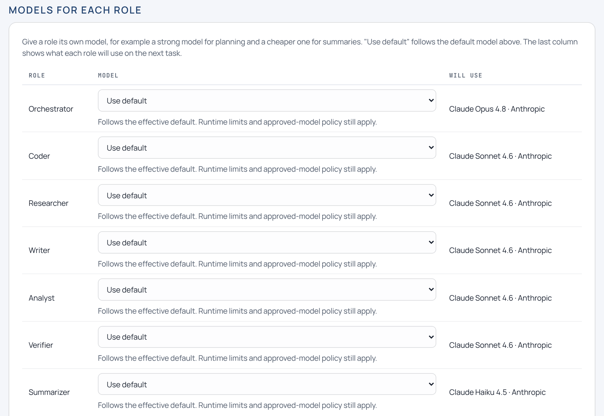
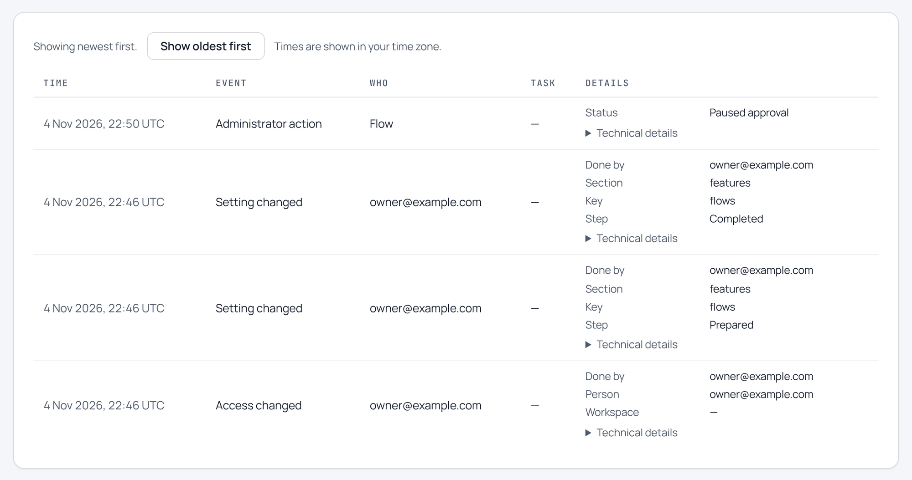
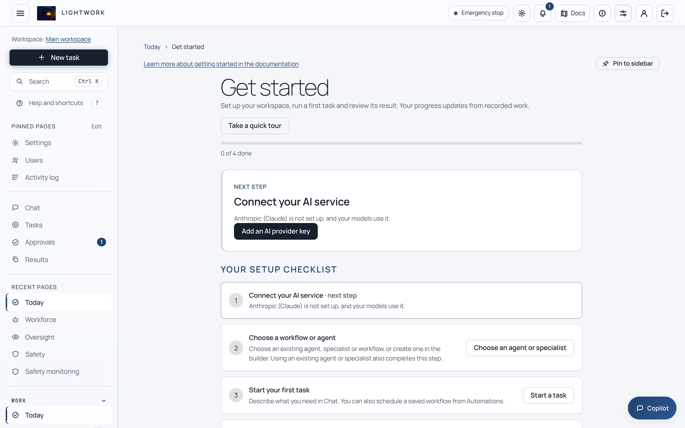
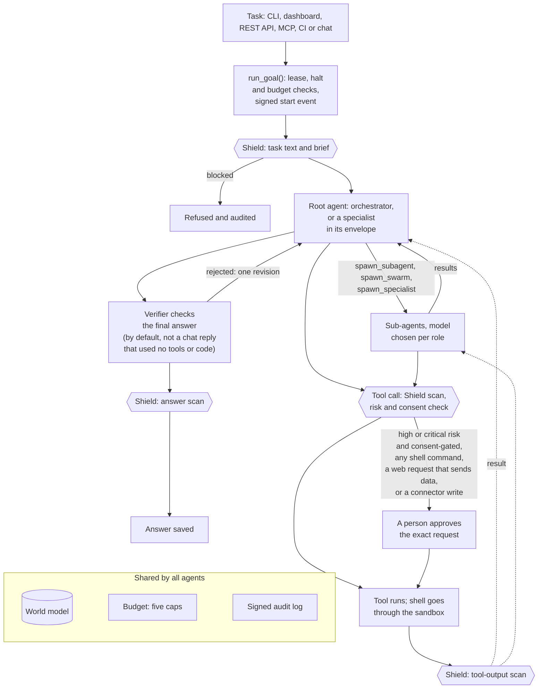

<p align="center">
  
</p>

<h1 align="center">Lightwork</h1>

<p align="center">
  <b>A self-hosted runtime for multi-agent AI&nbsp;work.</b><br>
  An orchestrator agent plans each task and hands parts of it to parallel sub-agents and built-in specialists,
  on the models you choose. Spending limits, a person's approval for connector writes, shell commands and web requests that send data,
  and a signed audit log are built into the runtime.
</p>

<p align="center">
  <a href="https://github.com/Daybreak-AI-Labs/LightworkOS/actions/workflows/ci.yml"></a>
  <a href="LICENSE"></a>
  <a href="docs/source-install.md"></a>
  
</p>

<p align="center">
  <b>Alpha.</b> Version 0.1.7 is unreleased. There is no GitHub release, PyPI package or published container image yet,
  so you <a href="docs/source-install.md">install from source</a> with Python 3.11 or 3.12. Configuration and APIs can change between versions (<a href="CHANGELOG.md">CHANGELOG.md</a>).
</p>

<p align="center">
  <picture><source media="(prefers-color-scheme: dark)" srcset="docs/assets/screenshots/approvals-dark.webp"></picture>
  <br><sub>A workflow run paused at its approval step. It was started without any list items, so its per-item AI step ran zero times and no model was called. Every screenshot here comes from a fresh install with no AI provider connected.</sub>
</p>

<table align="center">
<tr><td align="right"><b>2,031</b></td><td>specialist packs: role definitions with tool and risk limits</td></tr>
<tr><td align="right"><b>2,877</b></td><td>connector catalog entries; every write waits for a person</td></tr>
<tr><td align="right"><b>15</b></td><td>model providers, cloud or local</td></tr>
<tr><td align="right"><b>72 of 72</b></td><td>unsafe actions blocked in an offline benchmark with no model</td></tr>
<tr><td align="right"><b>47,000+</b></td><td>tests in the suite</td></tr>
</table>

<p align="center"><a href="#quickstart">Quickstart</a>&nbsp;· <a href="#proof-you-can-check">Proof</a>&nbsp;· <a href="#what-is-on-by-default">Defaults</a>&nbsp;· <a href="#see-it">Screenshots</a>&nbsp;· <a href="#how-a-task-runs">How&nbsp;it&nbsp;runs</a>&nbsp;· <a href="#safety-and-audit-in-depth">Safety</a>&nbsp;· <a href="#what-ships">What&nbsp;ships</a>&nbsp;· <a href="#ways-to-use-it">Interfaces</a>&nbsp;· <a href="#documentation">Docs</a></p>

## Built into the runtime

Lightwork is for teams that want agents on their own machines or cloud, with their own model keys or local models, and with approvals, spending limits and an audit trail they can check. The controls live in the runtime, not in the prompt:

- **People approve connector writes and consent-gated high-risk actions.** A connector write is first shown to a person as a preview (nothing is sent), with a digest of the exact request, and sent only after that person approves it. The agent cannot approve its own request, and no setting removes this step. Every shell command, every `http_fetch` request other than a plain GET or HEAD (any other method, or any request with a body), and by default every other consent-gated action rated high or critical risk, also asks a person.<br>*Where to check it:* [`governed_tools.py`](packages/maverick-core/maverick/governed_tools.py), the [governance benchmark](#proof-you-can-check)
- **Spending limits that hold under parallel work.** Five caps (input tokens, output tokens, dollars, wall-clock time, tool calls) are checked every time usage is recorded, so a run stops at the first call that crosses a cap that is set; a fresh install sets only the dollar and time caps. Estimated cost is reserved before each model call, so parallel sub-agents cannot all pass the check at once; a call that costs more than its estimate can still take a run past its cap. A model with no verified price stops the run instead of being billed at a guess.<br>*Where to check it:* [`budget.py`](packages/maverick-core/maverick/budget.py), [docs/task-limits.md](docs/task-limits.md)
- **Delegation with limits and a second opinion.** Agents start one sub-agent, a parallel swarm or a built-in specialist. By default depth is capped at 3, a task at 64 spawned agents, fan-out halves at each level (8, then 4, then 2), and spawning stops once 75% of the dollar cap is spent so the root agent can still answer. A separate verifier call checks the final answer and fails closed: an error in its model call counts as a rejection. A rejection sends the answer back for one revision, and a second rejection is returned with an uncertainty note. By default a chat reply that used no tools or code skips the check.<br>*Where to check it:* [`tools/spawn.py`](packages/maverick-core/maverick/tools/spawn.py), [`verifier.py`](packages/maverick-core/maverick/verifier.py)
- **An audit log you can verify.** Every event is hash-chained and Ed25519-signed by default; `lightwork audit verify` (today's day-file by default, every day-file with `--all`) and a [standalone Rust binary](rust/maverick-verify-audit/README.md) (one file per run) exit non-zero on any break. Tamper-evident against the service account only with an off-host record: by default the signing key sits on the same host, which catches accidental or unprivileged edits but not someone running as the service account. Supplying `MAVERICK_AUDIT_SIGNING_KEY` (or a KMS-wrapped `MAVERICK_AUDIT_SIGNING_KEY_WRAPPED`) keeps the key off local disk, but the signing process still holds it, so also keep [audit checkpoints](docs/audit-checkpoints.md) off-host and verify with a pinned public key.<br>*Where to check it:* A one-field edit fails both verifiers with `bad_hash`; [docs/audit-checkpoints.md](docs/audit-checkpoints.md)
- **Your models, your machines.** Anthropic, OpenAI, Azure, Bedrock, Vertex, Gemini, DeepSeek, xAI, Moonshot, OpenRouter, any OpenAI-compatible endpoint and the Codex CLI, or self-hosted Ollama, vLLM and TGI. Each agent role picks its own model, with an administrator allow-list on top. Enterprise mode (off by default) refuses a cloud model call before any prompt leaves the process.<br>*Where to check it:* `lightwork version` lists the providers; [docs/security-hardening.md](docs/security-hardening.md)
- **Screening at four points.** Agent Shield checks the task text, every tool call, every tool result and the final answer (rendered code diffs excepted), including text disguised with base64, hex, percent-encoding or look-alike characters. It is pattern matching: one layer among several, not a security boundary.<br>*Where to check it:* [docs/safety.md](docs/safety.md), [benchmarks/security/RESULTS.md](benchmarks/security/RESULTS.md)

## Proof you can check

- `python proof/run_proof.py`: **7 of 7** guarantees pass.<br>Least privilege; no money-moving tool in any finance pack; a dollar-limit gate ($4k release runs, $6k needs a person, a $60k wire is denied); read-not-write fleet access; segregation of duties; tampered handoffs rejected; audit-chain integrity with a co-located key. Real enforcement code against the shipped roster, no provider key.
- [Governance frontier](benchmarks/GOVERNANCE_FRONTIER_RESULTS.md): **72 of 72** scripted unsafe actions blocked; **48 of 48** benign lookalikes allowed (0.0% false positives)<br>40 fixed scenarios in 8 families (budget control, capability attenuation, destructive actions, egress, financial actions, secret output and more), each under 3 pinned order seeds, against a controls-off baseline that let all 72 unsafe effects through.
- [Harness overhead](benchmarks/HARNESS_OVERHEAD_RESULTS.md): **Zero** extra model calls, tokens, steps or tool calls; answers and effects byte-identical in **36 of 36** pairs; median **21.74 ms** per task (p95 103.16 ms)<br>What the control path costs per task, for an average of 6 durable evidence records per task (8 for tasks that end in a posting action, 4 for read-only tasks; approvals, prepare and commit receipts and signed audit rows), over 12 fixed tasks under 3 pinned seeds.

**Read these numbers for what they are.** Both benchmarks are offline, deterministic measurements of the control path with no model in the loop (the overhead run calls a deterministic stub), so they show that the controls work and what they cost, not how well agents do tasks. "Blocked" means the control returned a denial before a simulated effect; no live payment or deletion ran. Each manifest is self-signed with a key created on the measuring host (a co-located key): the signature shows the published files match the run, not who ran it. Timings come from one 4-CPU Linux host with Python 3.12.3 and are never asserted. No live-model results are recorded yet.

Check the signed results after installing (the first command needs only Python and the `cryptography` package):

```bash
python benchmarks/results/governance-frontier-v1/verify_manifest.py \
  benchmarks/results/governance-frontier-v1/measured-manifest.json \
  benchmarks/results/governance-frontier-v1/trusted-publisher.pub
python benchmarks/eval_governance_frontier.py --verify-tracked-artifacts
python benchmarks/eval_harness_overhead.py --verify-tracked-artifacts
```

### Engineering

- **Tests.** Over 47,000 tests. CI runs the whole suite in four shards on Python 3.11, again on 3.12, and again under the production security posture (signed audit, encryption at rest, fail-closed consent). A pull request runs the 3.11 legs on the tests its changes select; pushes to `main` run everything. The suite runs on Linux; Windows has a focused process-containment job and a manual full-suite workflow, and macOS gets build and frozen-binary checks.
- **More than 20 gates beyond Ruff fail the build,** including immutable world-model migrations and evaluator anchors, an additive-only gRPC contract, no ungated path into the tool registry, no outbound HTTP outside the guarded clients, no swallowed audit refusal, no `shell=True` outside the sandbox package and tests, an accessibility check of every dashboard template, and an out-of-process dispatch soak. Mypy runs in strict mode on a small set of boundary modules only. [CONTRIBUTING.md](CONTRIBUTING.md#lint-and-ci-gates) lists the gates.
- **Browsers and Windows packaging.** A path-filtered UI-regression workflow is set up to run Playwright journeys in real Chromium and an axe-core WCAG 2.x A/AA scan of high-traffic pages in three themes with no allowed exceptions. A Windows MSI acceptance workflow covers install, repair, upgrade, rollback and tampered-installer rejection.
- **Supply chain.** Every third-party GitHub Action is pinned to a full commit SHA, Python installs in CI resolve under exact pins (`requirements/ci.txt`; the docs build uses `requirements/docs.txt`), OSV-Scanner checks lockfiles across Python, Rust, npm, .NET, Go and Java with no advisory exceptions, and pip-audit, a high-severity bandit scan, a license policy that rejects GPL, AGPL and SSPL dependencies, and detect-secrets all fail the build on a finding. Every audit run that passes those checks uploads a CycloneDX SBOM of the release runtime.
- **Releases: designed, not yet exercised.** The release workflows build every wheel and sdist twice and refuse to publish unless the builds are byte-identical, sign artifacts with keyless Sigstore, and publish through PyPI Trusted Publishing. No release has been cut, so none of this has produced a published artifact yet.

## Quickstart

Requires Git and Python 3.11 or 3.12, the versions CI tests. Docker or Podman is optional but recommended (see the warning below).

```bash
git clone https://github.com/Daybreak-AI-Labs/LightworkOS
cd LightworkOS
python3 -m venv .venv
. .venv/bin/activate
python -m pip install --upgrade pip
python scripts/install_release_cohort.py --core-extra release-runtime,evidence-analysis
lightwork doctor     # exits 1 until an AI provider is connected; expected at first
lightwork dashboard  # http://127.0.0.1:8765
```

`install_release_cohort.py` installs the eight Lightwork packages together in one pip transaction, against the pinned constraints in `requirements/ci.txt` (the repository root is not itself a pip project); third-party dependencies come from PyPI. On Windows, use the [PowerShell commands](docs/source-install.md#windows-powershell), which call the virtual environment's programs by path instead of running the activation script. Post-install checks are in [Install from source](docs/source-install.md).

The first time you open the dashboard it asks you to create the owner account. It then shows a **Get started** page that offers to save initial settings (strict Shield, the shell and the main file-editing tools off, no per-task spending limit) and starts its checklist with connecting an AI provider. `lightwork init` is a separate terminal wizard with its own defaults ([below](#what-is-on-by-default)); it does not create the dashboard owner account. Once a provider is connected, try a first task that needs no file or program access:

```bash
lightwork start "Draft a one-page plan to reduce our customer support response time \
without adding headcount. State your assumptions and the facts you need from me."
```

> [!WARNING]
> **By default, agent commands run directly on this computer** (the `local` sandbox), with no isolation from its files or network. Each shell command waits for a person to approve that exact command (a headless run is denied), but an approved command runs with your account's access, and file tools change the work folder without asking. Use Docker or Podman (`--sandbox docker`) for any task you would not run yourself, and read the [execution posture](SECURITY.md#execution-posture) first.
>
> Until settings are saved there is no config file, so the shell and file-editing tools are available. The dashboard's **Save initial settings** turns them off whether or not Docker is running; `lightwork init` in consumer, express or `--fast` mode turns them off only when Docker is not running.

### Try it without an AI key

- `lightwork demo`: A short offline tour that finishes in seconds, in a throwaway directory: a learning cycle, a hindsight replay and a value report built from synthetic data.
- `python proof/run_proof.py`: The seven governance checks [above](#proof-you-can-check).
- `lightwork safety --json`: JSON that CI can check (it always exits 0): the deployment profile, whether Agent Shield is installed and its backend, the sandbox backend and whether it is anything other than `local`, and whether the enterprise egress lock is on.
- `lightwork airgap`: Looks for outbound paths in the configuration; a fresh install reports findings and exits 1.
- `lightwork compliance`: Maps active controls to the EU AI Act, GDPR, NIST AI RMF, the Colorado AI Act, NYC Local Law 144, EEOC and CCPA, and names the setting behind each gap.
- `lightwork assess templates`: Offline readiness questionnaires, among them CIS Controls v8.1, NIST SP 800-53 Rev. 5, FedRAMP Rev. 5, ISO/IEC 27001:2022, CMMC 2.0 Level 2, SOC 2, HIPAA and PCI DSS v4.0.1.
- `lightwork mcp`: The MCP server on stdio; the [client quickstarts](#ways-to-use-it) connect, list its tools and read facts with no model call.
- `maverick-evolve --demo`: A synthetic configuration-search loop.

To reproduce the screenshot at the top: on the dashboard's **Learning** page choose **Turn on workflows**, open the **Flow designer**, load the built-in *Process a list with review* template, then save, publish and run it with no input. With no list of rows, its per-row AI step runs zero times, so the run reaches its approval step without calling a model and waits on the **Approvals** page.

## What is on by default

| Area | On a fresh install | To change it |
|---|---|---|
| Where commands run | `local`: this computer, no isolation | `--sandbox docker` or `podman`, or **Permissions → Where work runs** in the dashboard |
| Agent Shield | On, built-in rules, `balanced` profile while no config file exists (the dashboard's initial settings and the wizard's consumer mode write `strict`; express and `--fast` keep `balanced`) | `strict`, `balanced`, `permissive` or `off` ([docs/safety.md](docs/safety.md)) |
| Connector writes to outside systems | Always wait for a person's approval | Cannot be turned off |
| Web requests that send data (`http_fetch` with any method other than GET or HEAD, or with a body) | Always wait for a person's approval; plain GET and HEAD run without asking | Cannot be turned off |
| Consent-gated actions rated high or critical risk | Ask a person (a headless run is denied); low and medium risk run without asking | `MAVERICK_CONSENT_MODE`, or enterprise mode (every gated action asks) |
| Spending limit per task | $2 and 30 minutes while no config file exists. The wizard's consumer, express and advanced modes offer the same, another limit or none; `lightwork init --fast` and the dashboard's **Save initial settings** set no per-task limit | `--max-dollars`, `--max-wall-seconds`, `lightwork init` |
| Models without a verified price | Stop the run | `[budget] strict_pricing = false` for estimate-only pricing |
| Signed audit log | On, with the signing key on this host | `MAVERICK_AUDIT_SIGNING_KEY` or `MAVERICK_AUDIT_SIGNING_KEY_WRAPPED` |
| Encryption at rest (AES-256-GCM) | On for task content, memory, attachments and recall stores; not for the audit log (closed day-files are encrypted only when someone seals them, for example with `lightwork audit seal`; today's file never is), `config.toml` or `.env` | [docs/encryption.md](docs/encryption.md) |
| Learning from runs | On: proposes skills locally, and an administrator admits each one before use | `[self_learning] enable = false` |
| Capability enforcement | Off | `MAVERICK_ENFORCE_CAPABILITIES=1`, or enterprise mode |
| Enterprise mode | Off | `MAVERICK_ENTERPRISE=1` or `[enterprise] mode = true` |
| Workflows (flow engine) | Off | `[flows] enable = true`, or **Turn on workflows** on the Learning page |
| Document knowledge retrieval | Off | `[knowledge] enable = true`, plus an API key for the default hosted (Voyage) embedder, or the optional local embedder |
| Messaging channels | Off until configured | `[channels.<name>] enabled = true`, plus that platform's credentials |
| Crash-resume checkpoints | Off | `[durable] enabled = true` |
| Dashboard address | `127.0.0.1:8765` (loopback; `--port` changes the port) | A host other than `127.0.0.1`, `localhost` or `::1` needs `MAVERICK_DASHBOARD_TOKEN` |

## See it

<p align="center">
  <picture><source media="(prefers-color-scheme: dark)" srcset="docs/assets/screenshots/permissions-dark.webp"></picture>
  <picture><source media="(prefers-color-scheme: dark)" srcset="docs/assets/screenshots/compliance-dark.webp"></picture>
  <picture><source media="(prefers-color-scheme: dark)" srcset="docs/assets/screenshots/flow-designer-dark.webp"></picture>
  
</p>

1. <b>Permissions.</b> After Get started's initial settings were saved, which block `shell`, `write_file`, `apply_patch` and `str_replace_editor`. The page says plainly that work runs on this computer, with no isolation, and where to choose a container.
2. <b>Compliance.</b> Checked live from the workspace's configuration: 7 protections on, 5 need action. A coverage report, not legal advice.
3. <b>Flow designer.</b> Add steps on the canvas, start from a built-in template, or describe a workflow in plain English (drafting needs a connected AI provider), then test, publish and run it. Workflows are off by default and were turned on for this capture.
4. <b>Copilot.</b> Help on every page. With no provider it offers its built-in page guide; it never changes anything by itself.

<details>
<summary>More screenshots: models for each role, activity log, first-run checklist</summary>
<br>

<p><br>
<sub><b>Models for each role.</b> The built-in defaults on a fresh install; no model was called. Each role can use a different provider and model.</sub></p>

<p><br>
<sub><b>Activity log.</b> Filtered to 4 Nov 2026: the owner's access, turning on workflows and the paused approval from the screenshot at the top.</sub></p>

<p><br>
<sub><b>Get started.</b> Where owner sign-in lands, after its initial settings were saved and before an AI service is connected.</sub></p>

</details>

## How a task runs



- **One entry point.** `run_goal()` takes an execution lease on the task, checks the halt switch and the spending limits, writes a signed start event, scans the task text, starts any configured MCP clients, builds and scans the assembled brief, runs the root agent, and scans the final summary (except a rendered code diff) before saving it.
- **The verifier** judges only the root's final answer, with a structured rubric by default. In a conversation (`lightwork chat`, dashboard chat or a messaging channel), a prose answer of up to 12,000 characters reached with no tool calls or code skips the verifier unless `MAVERICK_VERIFY_CHAT_ANSWERS=1`. An error in the verifier's model call counts as a rejection. A rejection sends the critique back for one revision; a second rejection is returned with an uncertainty note instead of looping, and an answer whose check runs out of budget is returned with a could-not-verify note. With the default models the orchestrator and verifier share a model family; set `MAVERICK_CROSS_FAMILY_VERIFIER` for a cross-family verifier (a multi-model panel is also opt-in). In coding mode, `--fail-to-pass` and `--pass-to-pass` tests replace the model judge, and `--best-of-n` keeps the patch that passes the most tests.
- **Models per role.** Each agent role (orchestrator, researcher, coder, writer, verifier, summarizer and more) resolves its model in a fixed order: a model chosen for that task in the dashboard, a per-role override, the global `--model`, the specialist's choice, the `[models]` table in `config.toml`, the dashboard pin, opt-in local-first and cost-aware routers, then the built-in defaults, which are Anthropic models until you choose others. Provider failover chains are opt-in and never retry a budget, egress or consent denial.
- **Long-running work.** An agent can stop and ask you a question; the task waits until `lightwork answer` and `lightwork resume`. A task stopped by a limit keeps its state and can resume with a higher cap or a different sandbox. `lightwork schedule goal "<cron>" "<text>"` with `lightwork worker` runs recurring tasks. Opt-in extras: review checkpoints every N dollars, tool calls or seconds, `--director supervised|semi|autonomous` presets, and crash-resume checkpoints with `lightwork rewind <goal> --to-step N [--fork]` for a single agent (not a spawn tree).
- **State and scale.** The world model is SQLite in WAL mode by default, or Postgres for a shared deployment (it has every world-model table and all but four optional read helpers, which callers fall back from; CI tests it against Postgres 16). Migrations are forward-only and checksum-locked across both backends. Tasks run in-process by default; an optional Redis queue carries HMAC-signed, expiring job envelopes, each consumed at most once (a crash loses that job). A CI soak gate pushes 60 tasks through the SQLite job queue to 4 concurrent workers and requires zero lost and zero duplicated (model calls stubbed). In the SQLite job queue, a worker that freezes past its lease has its job reclaimed and run again, so side effects are at-least-once.

## Safety and audit in depth

| Sandbox backend | Isolation |
|---|---|
| `local` (default) | None: commands run on the host, and the kernel logs a warning. Under the enterprise profile it is upgraded to an available container runtime, and the run fails closed if that runtime does not work. |
| `docker`, `podman` | A fresh `--rm` container per command with all Linux capabilities dropped, `no-new-privileges`, the invoking user's uid:gid instead of the image's user (a Windows host gets the image's default user, and running Lightwork as root means root in the container), a 512-process limit, a 4 GB memory cap and no network. Network, root, process and memory limits can be loosened in `[sandbox]`. |
| `gvisor`, `devcontainer` | Docker with the runsc runtime (fails closed unless Docker reports an approved runsc), or the same container hardening from a `devcontainer.json`. |
| `kubernetes` | Non-root pod, all capabilities dropped, read-only root filesystem, RuntimeDefault seccomp, no service-account token. With network off it refuses every command until the namespace has a deny-all egress NetworkPolicy (it checks that the policy exists, not live packet filtering). |
| `ssh`, `modal` | `ssh` runs on a remote host with that host's isolation. `modal` refuses every command while network is off (the default) and does not copy the workspace. |
| `firecracker` | An experimental scaffold, not a supported isolation backend. |

- **Enterprise mode** (off by default) refuses a cloud model call before any data leaves the process, refuses outbound calls through `httpx`, `requests` and `urllib` to public hosts that are not allow-listed (loopback and private-network addresses stay reachable), audits each denial, turns on capability enforcement, makes every consent-gated action ask, and refuses to sign audit events with a key kept on local disk, so set `MAVERICK_AUDIT_SIGNING_KEY` or `MAVERICK_AUDIT_SIGNING_KEY_WRAPPED` first. Runs need a local or allow-listed model endpoint (Ollama, vLLM, TGI), or they fail closed.
- **Capabilities** (off by default) are scoped grants over tools, a maximum risk level, file paths and network hosts. A sub-agent's grant can only narrow its parent's. N-of-M dual control can require several distinct approvers per risk band (off by default).
- **Keys and secrets.** Sandboxed commands get an environment with secret-looking variables removed, logs and tool output pass a secret redactor, URL fetches pin DNS and refuse private, loopback and cloud-metadata addresses, and installed plugins load only when an allowlist names them. An optional out-of-process [model proxy](go/model-proxy/README.md) holds a provider key (one upstream per proxy process) so it never enters the agent's process; it is not yet qualified against live provider traffic, and its default address matches the dashboard's, so set `MAVERICK_PROXY_LISTEN` when you run both.
- **Posture checks.** `lightwork safety --json` for CI; `lightwork airgap`, `lightwork compliance --strict` and `lightwork soc2` exit non-zero on findings; `lightwork halt` stops runs at their next checkpoint.
- **Audit tooling.** `lightwork audit verify`, `export` (JSONL or ArcSight CEF), `forward` (TCP or UDP syslog, HTTP(S), Datadog, Microsoft Sentinel), `checkpoint publish` and `checkpoint verify` (signed, numbered commitments kept elsewhere), `worm` (S3 Object Lock, opt-in) and `rotate-key`. A signed tip ledger catches a deleted or truncated past day-file; today's open file is anchored only after the day closes. The [Rust verifier](rust/maverick-verify-audit/README.md) checks one file's chain and accepts a pinned public key; checkpoints are described in [docs/audit-checkpoints.md](docs/audit-checkpoints.md).

**Stated limits.** The shield is pattern and heuristic matching: on a small in-repo set of 31 held-out attacks and 32 benign prompts ([benchmarks/security/RESULTS.md](benchmarks/security/RESULTS.md), measured 2026-07-29), its built-in rules catch 71.0% at a 6.2% false-positive rate at the `high` threshold used when no settings file exists, and 83.9% at the same 6.2% at the `medium` threshold that the dashboard's initial settings and the wizard's consumer mode choose, so treat that as regression evidence, not an efficacy claim. Enterprise egress control works at the application layer, so `curl` from a shell and raw sockets are not covered; pair it with sandbox network isolation and an OS or VPC deny rule. Coordination tools (spawning, `list_specialists`, agent messaging, `ask_user` and `find_tools`) stay allowed under capability enforcement, even past an allow-list or risk ceiling, unless `deny_tools` removes them. Losing an auto-generated encryption key loses the data it protects. The [threat model](docs/security/threat-model.md) states that no external penetration test has been published.

## What ships

- **2,031 built-in specialists** (domain packs) in more than 50 business suites, led by HR, sales, IT governance and risk, legal and finance, all passing `lightwork domains-lint --ci`. Each is a **governance definition, not a ready-to-run agent**: a persona, allowed and denied tools, a risk ceiling, a compartment, a workflow of at least three steps and a result contract. Many cannot start on a fresh install: Lightwork refuses to deploy a pack whose workflow names a tool that is not available, which blocks 965 of the 2,031 packs. For 686 of them the only missing tool is web search, off until `[capabilities] web_search = true`; the rest need an adapter or MCP connection to supply a named tool. Roster-wide invariant tests, each with a fault-injection control, check permissions, not answer quality: no drafting specialist can reach a state-changing tool, high-risk actions are never autonomous, a spawned agent never exceeds its parent's grant, and compartments stay sealed.
- **2,877 write-capable connector catalog entries**, built from two generic factories, one for REST and one for GraphQL. Each needs its own service address and credential, a write without confirmation returns a dry run, and a real write waits for approval. They are tested against synthetic responses only, so qualify each against your own endpoint ([docs/connectors.md](docs/connectors.md)). Alongside them: GET-only read seats, public-data sources (SEC EDGAR, FRED, Census, BLS, openFDA, ClinicalTrials.gov, CourtListener) that specialists in most suites are granted by default (FRED, Census and CourtListener each need their own API key), dedicated setups for systems such as ServiceNow, Snowflake, SAP, Workday, Salesforce and Stripe, and modules for Gmail, Microsoft Graph, Google Drive, Jira, Confluence and Notion.
- **External MCP servers** become agent tools when you add them under `[mcp_servers.<name>]` in `config.toml`, over stdio or Streamable HTTP, with calls screened by the Shield and optional SHA-256 pinning of the server program.
- **Workflows** (off by default): graphs of step types (agent, action, branch, switch, for-each, while, parallel, approval, delay, wait-for-event, try/catch scope, subflow, set-variable) with a visual designer and a plain-English drafter that needs a connected AI provider. A flow can propose changes to itself; by default a person applies each one.
- **Reviewable learning** (on by default): successful runs become proposed skills, distilled locally without a model call, and a proposed skill reaches later runs only after an administrator admits that exact version on the **Skills** page. Over 500 built-in skills ship with the kernel. Generating new executable tools, `lightwork refine` and `lightwork self-modify` are off by default ([docs/self-learning.md](docs/self-learning.md)).
- **Knowledge** (off by default): `maverick-knowledge` adds per-domain document search on SQLite or pgvector; the default hosted embedder needs an API key, and a local one is an optional extra ([docs/knowledge.md](docs/knowledge.md)).
- **Compliance tooling**, as reports and checks, not legal advice or attestations: `lightwork compliance`, `lightwork assess`, a regulatory compiler that turns regulation profiles (GDPR, the EU AI Act, HIPAA, NIST AI RMF, ISO/IEC 42001, SOC 2 and the US SR 11-7 model-risk guidance) into tool-call gates once you choose them, and `lightwork ropa`, `dpia` and `ai-act`, which pre-fill a GDPR record-of-processing scaffold, a DPIA scaffold and an EU AI Act self-assessment checklist from your own configuration, for your DPO or counsel to complete ([docs/compliance/README.md](docs/compliance/README.md)).
- **Demo apps.** Five standalone web apps in [`demo/`](demo) (data requests, GRC, two threat hunters, model risk) run without Lightwork installed and without a model; they are deterministic demos with no outside effects: their actions are proposals or are captured locally (the data-requests demo delivers its email to an in-process inbox).
- **Deployment recipes** in [`deploy/`](deploy): Docker and Compose, a Helm chart, a systemd VPS install, an AWS Terraform stack (ECS Fargate, RDS, EFS, an ALB) with a separate Kubernetes executor so model-generated commands never run in the application task, Kubernetes, ECS, Fly.io and Railway reference architectures, Postgres, and Prometheus and Grafana. No image is published, so every recipe builds from source; CI builds the Docker images ([docs/deployment.md](docs/deployment.md)).

## Ways to use it

| Interface | What you get | Default |
|---|---|---|
| **Dashboard** | More than 160 pages with a Ctrl+K page finder and a Copilot panel on every page. Copilot can only propose operations from a fixed catalog, which run after you confirm, under the same permissions as the page. Dark, light, solarized and high-contrast themes; page text is English. | `lightwork dashboard` on `127.0.0.1:8765`; many governance modules start switched off |
| **CLI** | 160+ commands, installed as both `lightwork` and `maverick` | Installed with the cohort |
| **REST API** | Over 3,000 operations under `/api/v1`, an OpenAPI 3.1 schema, Swagger UI at `/docs` and ReDoc at `/redoc` (ReDoc loads from a CDN), and live run events over Server-Sent Events and WebSocket ([docs/api.md](docs/api.md)) | Same sign-in as the dashboard; a local write needs a matching `Origin` header or an API key |
| **MCP server** | `lightwork mcp` speaks protocol 2025-11-25 and negotiates down to 2024-11-05, with tools to start, check, resume and answer tasks and to manage skills and facts | stdio; `--http` serves Streamable HTTP on `127.0.0.1:8771` and rejects any request without a bearer token (`MAVERICK_MCP_TOKEN`) |
| **Messaging** | `lightwork serve`: Telegram, Discord, Slack, Microsoft Teams, Mattermost, Signal, email, Matrix, Bluesky, Mastodon, Threads, IRC, RCS, WhatsApp (Meta Cloud API or Twilio), SMS (Twilio), iMessage (macOS only) and voice (inbound through Vapi or Retell) | Each channel off until configured with its credentials |
| **CI** | A GitHub Action that runs a task under a hard dollar cap, a reusable workflow that posts its findings as a pull-request comment, and a GitLab CI template | The Action defaults to $1 and a Docker sandbox; the GitLab template caps spend at $1 but defaults to the `local` sandbox |
| **gRPC and A2A** | A gRPC API (StartGoal, StreamEpisode, Cancel, GetStatus and RunGoal, behind an additive-only contract gate) and an A2A 0.3.0 endpoint for other agents (each remote task capped at $5, one hour and depth 3 by default) | Both off; gRPC always requires a bearer token |

**From any language.** MCP is the cross-language interface. CI runs each of these client programs end to end against a live `lightwork mcp` server, with no model call (path-filtered workflows on pushes to `main` and on pull requests):

- TypeScript / JavaScript: [docs/clients/typescript-quickstart.md](docs/clients/typescript-quickstart.md)
- Go: [docs/clients/go-quickstart.md](docs/clients/go-quickstart.md)
- Rust: [docs/clients/rust-quickstart.md](docs/clients/rust-quickstart.md)
- C# / .NET: [docs/clients/csharp-quickstart.md](docs/clients/csharp-quickstart.md)
- Java / JVM: [docs/clients/java-quickstart.md](docs/clients/java-quickstart.md)

**In CI.** Pin the action to a reviewed full commit SHA:

```yaml
- uses: Daybreak-AI-Labs/LightworkOS/deploy/github-action@<full-40-character-commit-sha>
  with:
    goal: "Summarize this PR and flag anything risky."
    max-dollars: "0.50"
    anthropic-api-key: ${{ secrets.ANTHROPIC_API_KEY }}
```

[docs/github-action.md](docs/github-action.md) covers setup, [deploy/github-action](deploy/github-action/README.md) lists every input and output, and the GitLab template is in [deploy/gitlab-ci](deploy/gitlab-ci/README.md). Extend Lightwork with Python entry-point plugins ([docs/plugins.md](docs/plugins.md)) or TypeScript tools ([`sdks/plugin-ts`](sdks/plugin-ts)).

**Also in the repository, as source only.** A Tauri desktop shell, an unreleased Windows MSI candidate, a preview mobile companion (read-only by default), VS Code, JetBrains (preview), Zed (preview), Neovim and Emacs integrations, a browser extension (off by default), embeddable chat and status widgets, and a standard-library Python REST client. None is published to a store, marketplace, npm or PyPI, and the editor integrations and browser extension are not built in CI.

<details>
<summary><b>CLI essentials</b> (<code>lightwork --help</code> lists the top-level commands; add <code>--help</code> to a command to see its subcommands)</summary>

| Command | What it does |
|---|---|
| `lightwork init` | Setup wizard (`--fast` for recommended defaults, `--from-file` for headless provisioning) |
| `lightwork doctor` / `preflight` / `version` | Diagnose the install; offline readiness check; versions, schema, shield backend and providers |
| `lightwork dashboard` | Dashboard and REST API at `http://127.0.0.1:8765` |
| `lightwork start "GOAL"` | Run a task once (`--max-dollars`, `--max-wall-seconds`, `--sandbox`, `--template`, `--domain`) |
| `lightwork chat` | Interactive session; each turn becomes a task |
| `lightwork status` / `logs` / `answer` / `resume` | Recent tasks, recent audit entries, answer an agent's question, resume a blocked task |
| `lightwork schedule goal` / `worker [--once]` | Recurring tasks on cron expressions, and the worker that runs them |
| `lightwork serve` / `mcp [--http]` | Messaging-channel server; MCP server (HTTP needs a token) |
| `lightwork safety [--json]` / `airgap` / `compliance [--strict]` | Posture checks that can gate CI |
| `lightwork audit verify` / `export` / `forward` / `checkpoint` | Verify, export, ship and checkpoint the signed audit log |
| `lightwork whoami` / `capability` | Show a principal's effective grant; revoke or restore grants |
| `lightwork spend` / `budget` | Spend by task and tag; cost history |
| `lightwork halt` / `unhalt` | Stop runs at their next checkpoint; clear the halt |

</details>

## Packages and layout

Lightwork is split into eight Python distributions, installed from source and versioned together as one cohort (none is published to PyPI yet):

| Distribution | Path | What it contains |
|---|---|---|
| `maverick-agent` | [`packages/maverick-core`](packages/maverick-core) | The kernel: orchestrator, tools, sandbox backends, world model, budget, audit log, CLI |
| `maverick-shield` | [`packages/maverick-shield`](packages/maverick-shield) | The Shield's screening chokepoints and the built-in rule set that runs in every install (the separate `agent-shield` SDK it can use is not bundled and not on PyPI) |
| `maverick-channels` | [`packages/maverick-channels`](packages/maverick-channels) | Messaging adapters used by `lightwork serve` |
| `maverick-dashboard` | [`packages/maverick-dashboard`](packages/maverick-dashboard) | FastAPI dashboard and REST API at `/api/v1` |
| `maverick-mcp-server` | [`packages/maverick-mcp`](packages/maverick-mcp) | MCP server that exposes Lightwork to any MCP client |
| `maverick-evolve` | [`packages/maverick-evolve`](packages/maverick-evolve) | Configuration-only evolutionary search with an evaluation harness; it never changes code |
| `maverick-knowledge` | [`packages/maverick-knowledge`](packages/maverick-knowledge) | Per-domain document retrieval for agents (off by default) |
| `maverick-installer` | [`apps/installer-cli`](apps/installer-cli) | The setup wizard behind `lightwork init` |

Elsewhere: `apps/` and `extensions/` (desktop, mobile, editor and browser), `sdks/` (TypeScript plugin SDK, Python REST client, native consent SDK), `rust/` (audit verifier and optional native scanner), `go/` (model proxy), `deploy/`, `benchmarks/` and `proof/` (the measurements above), `demo/`, `examples/`, `scripts/` and `requirements/` (pinned constraints). [ARCHITECTURE.md](ARCHITECTURE.md) and [docs/architecture.md](docs/architecture.md) go deeper.

**Naming.** The command-line tool is installed as both `lightwork` and `maverick`, which run the same program. Python distributions, modules, environment variables and the config directory use the original codename (`maverick-agent`, `MAVERICK_*`, `~/.maverick/`).

## Documentation

| Topic | Where |
|---|---|
| Install and first run | [docs/source-install.md](docs/source-install.md), [docs/getting-started.md](docs/getting-started.md), [docs/task-limits.md](docs/task-limits.md) |
| Configuration | [docs/configuration.md](docs/configuration.md), [docs/env-vars.md](docs/env-vars.md) |
| Safety, hardening and encryption | [docs/safety.md](docs/safety.md), [docs/security-hardening.md](docs/security-hardening.md), [docs/encryption.md](docs/encryption.md), [SECURITY.md](SECURITY.md) |
| Threat model and audit checkpoints | [docs/security/threat-model.md](docs/security/threat-model.md), [docs/audit-checkpoints.md](docs/audit-checkpoints.md) |
| Deployment | [docs/deployment.md](docs/deployment.md), [docs/reference-architectures.md](docs/reference-architectures.md), [deploy/helm/README.md](deploy/helm/README.md) |
| REST, MCP, gRPC and A2A | [docs/api.md](docs/api.md), [docs/clients/README.md](docs/clients/README.md), [docs/grpc.md](docs/grpc.md), [docs/a2a.md](docs/a2a.md) |
| Connectors, plugins and compliance | [docs/connectors.md](docs/connectors.md), [docs/plugins.md](docs/plugins.md), [docs/compliance/README.md](docs/compliance/README.md) |
| Benchmarks and proof | [benchmarks/README.md](benchmarks/README.md), [proof/RESULTS.md](proof/RESULTS.md) |
| Feature catalogue and changes | [docs/FEATURES.md](docs/FEATURES.md), [CHANGELOG.md](CHANGELOG.md) |
| Interface contracts and the RFC process | [docs/contracts/README.md](docs/contracts/README.md), [docs/rfcs/README.md](docs/rfcs/README.md) |

## Contributing

Contributions are welcome. [CONTRIBUTING.md](CONTRIBUTING.md) covers the development setup, tests, lint and CI gates, and how changes reach `main`. In short:

```bash
git clone https://github.com/Daybreak-AI-Labs/LightworkOS
cd LightworkOS
bash .devcontainer/post-create.sh       # editable installs plus dev tools in .venv
. .venv/bin/activate
python -m pytest -q -n auto --dist loadfile
python -m ruff check .
bash scripts/pre-push-lint.sh           # the CI lint gates, run locally
```

`make help` lists shortcuts for these steps (`make dev`, `make test`, `make lint`).

Pull request titles follow Conventional Commits, and your first pull request signs the [Contributor License Agreement](CLA.md) with one line in its description. Participation is governed by the [Code of Conduct](CODE_OF_CONDUCT.md). [GOVERNANCE.md](GOVERNANCE.md) explains how decisions are made, [MAINTAINERS.md](MAINTAINERS.md) lists the maintainers, and [RELEASING.md](RELEASING.md) describes how releases are made. For questions and bug reports, see [SUPPORT.md](SUPPORT.md). Report security vulnerabilities privately as described in [SECURITY.md](SECURITY.md), not in a public issue.

## License

Lightwork is licensed under the [Apache License 2.0](LICENSE); see also [NOTICE](NOTICE) and [THIRD-PARTY-NOTICES.md](THIRD-PARTY-NOTICES.md). The Lightwork name and logo are trademarks and are not covered by the license; see [TRADEMARK.md](TRADEMARK.md).

Lightwork is developed by Daybreak AI Labs; copyright is held by Christopher Day (see [NOTICE](NOTICE)).
